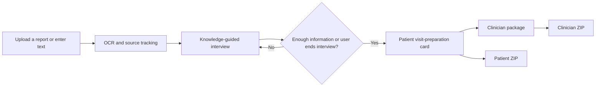
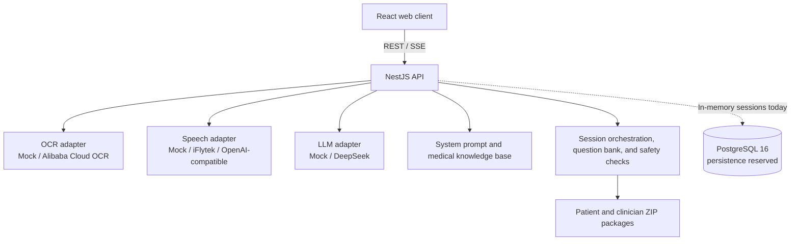

# Medical Evidence Assistant

English | [简体中文](./README.md)

An AI assistant that helps patients and caregivers organize medical examination records. Users can upload report images, paste report text, or add medical history by voice. OCR, a constrained knowledge base, and an LLM-driven interview turn these inputs into a patient visit-preparation card, a structured clinician package, and downloadable ZIP archives.

> This project supports document organization and clinical communication. It does not diagnose disease, assess malignancy, recommend medication, surgery, biopsy, or follow-up intervals, and it does not replace professional medical judgment.

## Highlights

- **Conversational collection**: maintains one case context and asks one high-priority question per turn instead of presenting a long intake form.
- **Multimodal input**: accepts report-image OCR, pasted text, and in-browser voice transcription; users confirm transcripts before they enter the case context.
- **Knowledge-guided questions**: combines a stable question bank, examination-area rules, and missing-document rules to prioritize useful information.
- **Structured flow control**: the model returns an `ask` or `generate_patient_view` action, while the backend owns final card generation and prevents premature transitions.
- **Two audience-specific outputs**: produces a plain-language patient card and an eight-section package designed for clinician scanning, both copyable and downloadable as ZIP archives.
- **Safety by design**: system prompts, section allowlists, backend validation, and automated tests constrain unsafe output; model reasoning and internal rules are never shown to users.

## Workflow



The patient visit-preparation card has four fixed sections:

1. Terms in the report worth understanding
2. Information a clinician may ask about
3. Questions to confirm with a clinician
4. Records worth bringing to the visit

The clinician package has eight fixed sections: sources, chief concern or reason for examination, timeline, examination summary, patient-supplied information, available records, missing records, and a safety statement.

## Architecture



The repository is organized as an npm-workspaces monorepo:

| Path | Responsibility |
| --- | --- |
| `apps/web` | React 19 + Vite chat UI, uploads, recording, streamed result cards, and downloads |
| `apps/api` | NestJS 11 API, session orchestration, OCR/speech/LLM adapters, safety checks, and ZIP generation |
| `packages/shared` | Shared frontend/backend data contracts and TypeScript types |
| `交接文档/交接文档/03_知识库文件` | Question bank, examination-area rules, missing-record rules, and output templates |
| `tests/evaluation` | Deterministic regression tests and a real-provider end-to-end flow |
| `scripts` | Docker demo start and stop scripts |

## Technology

- Frontend: React 19, TypeScript, Vite 6, Lucide React
- Backend: Node.js, NestJS 11, Server-Sent Events
- AI services: DeepSeek OpenAI-compatible API, Alibaba Cloud OCR, iFlytek speech-to-text
- Data and files: in-memory sessions, Docker volumes, PostgreSQL 16 reserved for persistence
- Testing and deployment: Vitest, Docker Compose, Nginx

## Quick Start

### Local development

Requirements: Node.js 20+ and npm 10+.

```powershell
Copy-Item .env.example .env
npm install --include-workspace-root
npm run build
npm test
```

The default configuration uses deterministic mock AI services, so the complete workflow can be explored without third-party credentials. Start the API and web client separately:

```powershell
# Terminal 1
npm run dev:api

# Terminal 2
npm run dev:web
```

Open [http://localhost:3000](http://localhost:3000). The API runs at `http://localhost:3001` by default.

### Docker demo

With Docker Desktop running:

```powershell
Copy-Item .env.example .env
npm run start:demo
```

Stop the stack with:

```powershell
npm run stop:demo
```

Docker Compose starts the web client, API, and PostgreSQL, with volumes for uploaded and generated files.

## Real AI Providers

Inject credentials through a local `.env` file or deployment environment variables only. Never commit them to Git.

```dotenv
LLM_PROVIDER=deepseek
LLM_BASE_URL=https://api.deepseek.com
LLM_API_KEY=your-key
LLM_MODEL=your-model

VISION_PROVIDER=aliyun_ocr
ALIYUN_ACCESS_KEY_ID=your-access-key-id
ALIYUN_ACCESS_KEY_SECRET=your-access-key-secret

SPEECH_PROVIDER=iflytek
IFLYTEK_APP_ID=your-app-id
IFLYTEK_API_KEY=your-api-key
IFLYTEK_API_SECRET=your-api-secret
```

The `openai_compatible` speech adapter can connect to other transcription services. See [`.env.example`](./.env.example) for all options.

## Testing

```powershell
npm run build
npm test
```

The deterministic suite currently contains 11 tests covering question-bank parsing, one-question-per-turn behavior, asked/provided-information subtraction, Chinese upload filenames, OCR context, reasoning isolation, structured action control, patient and clinician result generation, medical safety boundaries, and ZIP packaging.

A real-provider flow is also included:

```powershell
npm run test:e2e:real
```

With real OCR and LLM credentials configured, this script runs the complete flow: upload a de-identified test report, conduct a multi-turn interview, generate the patient card, generate the clinician package, and download both ZIP archives.

## Safety and Privacy

- Users should remove names, phone numbers, government IDs, visit IDs, admission IDs, examination IDs, and detailed addresses before uploading.
- The system reads text from reports; it does not diagnose from raw ultrasound, CT, X-ray, or MRI images.
- Model reasoning, knowledge-base filenames, matched rules, internal classifications, and the Evidence Graph are not exposed.
- The assistant does not provide diagnoses, malignancy assessments, medication, surgery, biopsy, or specific follow-up intervals.
- Medical decisions remain with clinicians after reviewing history, physical examination, original images, and any necessary tests.

## Project Status

This repository is a demonstration-ready MVP. The full conversation flow, result cards, downloadable packages, and real-provider adapters are implemented. Session state is currently held in API process memory; PostgreSQL is included as a foundation for future persistence. Accounts, longitudinal records, page-by-page PDF OCR, automatic de-identification, and HIS/LIS/PACS integrations are outside the current release scope.
