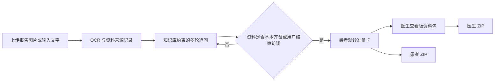
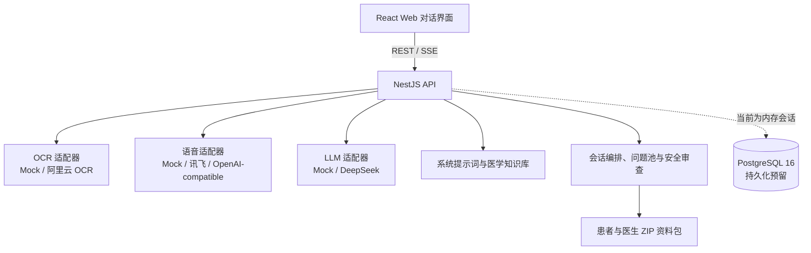

# 医检证据助手

[English](./README.en.md) | 简体中文

面向患者及陪诊者的医疗检查资料整理智能体。用户可以上传检查报告图片、粘贴报告文字或用语音补充病史；系统通过 OCR、知识库约束和大语言模型多轮访谈补齐关键信息，最终生成患者就诊准备卡、医生查看版资料包及可下载的 ZIP 文件。

> 本项目用于资料整理和就诊沟通辅助，不提供疾病诊断、良恶性判断、用药、手术、穿刺或复查周期建议，也不替代医生的专业判断。

## 项目亮点

- **聊天式资料收集**：围绕同一病例持续对话，每轮只追问一项最关键的信息，避免传统长表单带来的填写负担。
- **多模态输入**：支持检查报告图片 OCR、报告文字粘贴和浏览器录音转写；转写结果先由用户确认，再进入病例上下文。
- **知识库驱动追问**：结合基础问题池、检查部位规则和资料缺口规则，优先收集对就诊沟通有价值的信息。
- **结构化流程控制**：模型返回 `ask` 或 `generate_patient_view` 动作，由后端控制最终卡片生成，防止普通回复误触发结果页。
- **双版本结果交付**：生成通俗的患者就诊准备卡和便于医生扫读的八栏结构化资料包，并支持复制与 ZIP 下载。
- **医疗安全前置**：通过系统提示词、栏目白名单、后端审查和自动化测试共同限制越界表达；模型推理文本和内部规则不会展示给用户。

## 使用流程



患者就诊准备卡固定包含：

1. 报告里需要理解的关键词
2. 医生可能会追问的信息
3. 建议向医生确认的问题
4. 就诊前建议补充的资料

医生查看版资料包固定包含资料来源、主诉或检查原因、病程时间线、检查资料整理、患者补充信息、已有检查资料、仍缺资料和安全声明。

## 系统架构



项目采用 npm workspaces Monorepo：

| 目录 | 职责 |
| --- | --- |
| `apps/web` | React 19 + Vite 单页对话界面、附件上传、录音、流式结果卡片与下载交互 |
| `apps/api` | NestJS 11 API、会话编排、OCR/语音/LLM 适配、医疗安全审查与 ZIP 生成 |
| `packages/shared` | 前后端共享的数据结构与接口类型 |
| `交接文档/交接文档/03_知识库文件` | 问题池、检查部位规则、资料缺口规则与输出模板 |
| `tests/evaluation` | 稳定回归测试和真实供应商连续链路测试 |
| `scripts` | Docker 演示环境启动与停止脚本 |

## 技术栈

- 前端：React 19、TypeScript、Vite 6、Lucide React
- 后端：Node.js、NestJS 11、Server-Sent Events
- AI 服务：DeepSeek OpenAI-compatible API、阿里云 OCR、讯飞语音转写
- 数据与文件：内存会话、Docker Volume、PostgreSQL 16（持久化预留）
- 测试与部署：Vitest、Docker Compose、Nginx

## 快速开始

### 本地开发

环境要求：Node.js 20+、npm 10+。

```powershell
Copy-Item .env.example .env
npm install --include-workspace-root
npm run build
npm test
```

默认配置使用确定性的 Mock AI 服务，无需第三方密钥即可体验完整流程。分别启动前后端：

```powershell
# 终端 1
npm run dev:api

# 终端 2
npm run dev:web
```

访问 [http://localhost:3000](http://localhost:3000)。API 默认运行在 `http://localhost:3001`。

### Docker 演示环境

安装并启动 Docker Desktop 后运行：

```powershell
Copy-Item .env.example .env
npm run start:demo
```

停止服务：

```powershell
npm run stop:demo
```

Docker Compose 会启动 Web、API 和 PostgreSQL 三个服务，并使用 Volume 保存上传附件和生成文件。

## 接入真实 AI 服务

所有密钥只通过本地 `.env` 或部署环境变量注入，不应提交到 Git。主要配置项如下：

```dotenv
LLM_PROVIDER=deepseek
LLM_BASE_URL=https://api.deepseek.com
LLM_API_KEY=your-key
LLM_MODEL=your-model

VISION_PROVIDER=aliyun_ocr
ALIYUN_ACCESS_KEY_ID=your-access-key-id
ALIYUN_ACCESS_KEY_SECRET=your-access-key-secret

SPEECH_PROVIDER=iflytek
IFLYTEK_APP_ID=your-app-id
IFLYTEK_API_KEY=your-api-key
IFLYTEK_API_SECRET=your-api-secret
```

也可以通过 `openai_compatible` 语音适配器连接其他转写服务。完整配置项见 [`.env.example`](./.env.example)。

## 测试与验证

```powershell
npm run build
npm test
```

当前稳定测试包含 11 个用例，覆盖问题池解析、单问题追问、已问/已提供信息差集、中文文件名上传、OCR 上下文、推理文本隔离、结构化 Action 控制、患者卡与医生包生成、医疗安全边界及 ZIP 打包。

仓库还提供真实供应商链路脚本：

```powershell
npm run test:e2e:real
```

该脚本会使用配置好的 OCR 与大语言模型服务，执行“上传脱敏测试图片 → 连续多轮补充 → 生成患者卡 → 生成医生包 → 下载两个 ZIP”的完整流程。运行前请配置真实服务凭据。

## 安全与隐私边界

- 上传前应删除姓名、手机号、身份证号、门诊号、住院号、检查号和详细住址等个人信息。
- 系统只读取检查报告上的文字，不对 B 超、CT、X 光或 MRI 原始影像作诊断。
- 不展示模型思考过程、知识库文件名、命中规则、内部分类或 Evidence Graph。
- 不给出确诊、良恶性、用药、手术、穿刺和具体复查周期结论。
- 医疗决策始终应由医生结合病史、体格检查、原始影像和必要检查综合判断。

## 当前阶段

本项目处于可演示 MVP 阶段。完整对话闭环、结果卡、资料包和真实服务适配已经实现；当前会话状态仍保存在 API 进程内存中，PostgreSQL 仅作为后续持久化预留。账号体系、长期病历库、PDF 逐页 OCR、自动脱敏和医院 HIS/LIS/PACS 对接不在当前版本范围内。
