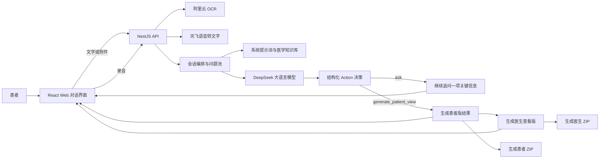

# 医检证据助手技术路线说明

更新时间：2026 年 7 月 15 日

## 1. 项目概述

“医检证据助手”是一款面向患者和医生的医疗检查资料整理工具。系统以 AI 对话为主要交互方式，接收患者上传的检查报告图片、粘贴的报告文字和语音补充信息，通过 OCR、语音转文字、知识库约束和大语言模型多轮访谈，逐步补齐病程资料，最终生成患者就诊准备卡、医生查看版资料包及对应的可下载 ZIP 文件。

本系统不替代医生诊断、治疗或随访决策。技术路线的重点不是对医学影像进行诊断，而是识别检查报告中的文字证据、整理患者已提供的信息、发现仍缺资料，并帮助患者更完整地向医生说明情况。

## 2. 技术路线总览

系统采用“Web 单页应用 + 模块化后端 API + 可替换 AI 服务 + Docker Compose 部署”的技术路线。



核心设计原则如下：

1. 前端只负责交互和展示，不直接调用 AI 服务，也不保存 API 密钥。
2. 后端统一负责 OCR、语音转写、模型调用、会话状态和输出安全控制。
3. 系统提示词和知识库由后端管理，在每个新会话的第一次模型交互中注入。
4. 多轮访谈以 AI 对话为主，后端使用结构化动作和问题池做必要约束。
5. 患者版和医生版由独立生成流程产生，不能由普通聊天标题误触发。
6. 内部分类、知识库命中和模型思考过程不向患者或医生展示。

## 3. 技术栈

| 层级 | 当前采用技术 | 主要用途 |
| --- | --- | --- |
| 前端 | React 19、Vite 6、TypeScript | 单页 AI 对话界面、附件上传、语音录制、结果卡片和下载交互 |
| 图标与界面 | lucide-react、原生 CSS | 构建轻量、清晰的医疗资料整理界面 |
| 后端 | Node.js、NestJS 11、TypeScript | 提供会话、文件、消息、生成和资料包 API |
| 实时输出 | Server-Sent Events（SSE） | 流式传输普通回复、患者版卡片和医生版卡片 |
| 大语言模型 | DeepSeek OpenAI-compatible API | 多轮追问决策、患者版内容生成和医生版内容生成 |
| 报告文字识别 | 阿里云通用文字识别 OCR SDK | 提取检查报告图片中的文字 |
| 语音转文字 | 讯飞中英识别大模型 WebSocket API | 将患者录音转成可编辑文字 |
| 文件打包 | AdmZip | 生成患者资料包和医生资料包 ZIP |
| 数据与文件 | 内存会话、Docker Volume、本地上传目录 | MVP 会话状态维护、附件和生成文件保存 |
| 数据库服务 | PostgreSQL 16 | 已纳入 Docker 部署，为后续会话持久化预留 |
| 测试 | Vitest、Node.js 真实链路测试脚本 | 自动化功能回归及真实 OCR、DeepSeek 端到端验证 |
| 部署 | Docker、Docker Compose、Nginx | 一键启动 Web、API 和 PostgreSQL 服务 |

项目采用 Monorepo 组织方式，包含前端应用、后端应用和共享类型包，使前后端接口类型保持一致。

## 4. 输入资料处理路线

### 4.1 文字输入

患者可以直接粘贴检查报告文字或补充病程信息。后端将本轮输入与已上传资料、已收集信息、历史消息和会话状态组合后交给对话编排模块处理。

### 4.2 检查报告图片

图片处理链路如下：

```text
上传图片
-> 后端保存原始附件并记录资料来源
-> 调用阿里云通用文字识别
-> 获取报告文字
-> 将 OCR 结果加入当前病例上下文
-> DeepSeek 根据报告内容和知识库决定下一条追问
```

系统仅将 OCR 用于读取报告单上的文字，不根据原始 B 超、CT、X 光或 MRI 影像自行诊断。识别失败时，系统提示用户重新上传清晰图片或粘贴报告文字，不编造无法识别的内容。

### 4.3 语音输入

前端使用浏览器录音能力采集音频，停止录音后将音频发送至后端。后端调用讯飞语音转文字服务，转写结果先返回输入框，由患者确认或修改后再发送。

该设计可以减少口述病程的输入成本，同时避免未经确认的转写结果直接进入病例资料。

## 5. 系统提示词与知识库

系统提示词负责定义智能体角色、工作流程、输出格式和医疗安全边界。知识库由以下五类文件组成：

1. 基础问题库及现病史、既往史问题池。
2. 诊断建议缺口规则。
3. 检查项目与检查部位对照表。
4. 正常、异常和资料不确定的内部判断规则。
5. 患者版和医生版摘要模板。

新会话创建时，后端读取当前版本的系统提示词和知识库文件，形成会话级 Prompt Context。在该会话第一次调用模型时注入完整知识上下文；后续交互复用已经建立的会话状态、历史消息和已收集资料，不在每轮重复注入完整知识库。

知识库用于约束模型的追问方向和优先级，但知识库文件名、命中规则、内部分类、Evidence Graph、原文依据及引用文档均不在用户界面展示。

## 6. 多轮访谈与流程控制

系统不是固定表单，也不使用简单的“达到指定轮数就结束”规则。每轮非结束消息都先由 DeepSeek 返回结构化决策：

```json
{
  "action": "ask",
  "reply": "给患者展示的回复",
  "missingCriticalInfo": ["仍缺的关键信息"],
  "selectedQuestionId": "问题池中的可选 ID",
  "coveredQuestionIds": ["患者已经提供的信息标签"]
}
```

其中：

- `action=ask`：继续追问一项最关键的信息。
- `action=generate_patient_view`：资料已基本齐备，进入患者版独立生成流程。
- 用户点击“结束访谈”或明确表示不再补充时：直接进入患者版生成流程，并在结果中保留仍缺资料。

后端只认结构化 `action`，不再通过回复中是否出现“患者版病程梳理”等标题猜测流程状态。因此，即使普通回复误写了结果标题，只要动作仍为 `ask`，前端也不会生成最终卡片。

### 6.1 问题池差集机制

现病史和既往史问题使用 12 个带稳定 ID 和优先级的问题池。会话内部记录：

- AI 已经问过的问题。
- 患者主动提供的信息所覆盖的问题。

访谈中每轮只提出一个最关键问题。最终患者卡中的“医生可能会追问你的信息”由后端计算：

```text
剩余问题 = 固定问题池 - 已问问题 - 患者主动覆盖问题
```

系统最多展示 5 个真实未覆盖问题，不重复已经询问或患者已经回答的内容。检查报告对应的化验、影像和医生意见等资料缺口，继续按照医学知识库单独追问，不受病史问题池限制。

## 7. 流式生成与前端展示

普通聊天回复、患者版病程梳理和医生查看版资料包均通过 SSE 流式返回。前端在生成开始时直接创建对应的卡片容器，再逐步填充内容，避免先显示纯文本、结束后才突然切换为卡片。

DeepSeek 深度思考模式可在后端开启。模型返回的 `reasoning_content` 只用于模型内部推理，后端主动丢弃该字段，不写入会话记录，也不发送到前端；用户只能看到最终回答内容。

## 8. 结果生成与资料包

### 8.1 患者版病程梳理

患者版使用通俗表达，当前固定包含四部分：

1. 报告里需要理解的关键词。
2. 医生可能会追问的信息。
3. 建议向医生确认的问题。
4. 就诊前建议补充的资料。

### 8.2 医生查看版资料包

医生版采用更结构化的表达，当前固定包含八部分：

1. 资料来源。
2. 主诉或检查原因。
3. 病程时间线。
4. 检查资料整理。
5. 患者补充信息。
6. 已有检查资料。
7. 仍缺资料。
8. 安全声明。

后端对两类结果实施栏目白名单。即使模型生成了旧栏目、内部字段或不属于当前版本的内容，最终在线卡片和 ZIP 文件也只保留允许的栏目。

### 8.3 ZIP 资料包

患者资料包包含患者就诊准备卡、资料清单和原始附件；医生资料包包含医生查看版资料、资料来源清单和原始附件。ZIP 内不打包知识库、模型调用日志、内部判断标签或调试字段。

## 9. 医疗安全控制

系统通过系统提示词、知识库约束、后端流程控制和结果栏目白名单共同实施安全边界：

1. 不给出确诊结论。
2. 不提供用药、手术或穿刺建议。
3. 不给出具体复查周期或随访决策。
4. 不根据原始医学影像直接作诊断。
5. 不编造报告中未出现的检查结果。
6. 涉及诊断和治疗决策时，引导用户由医生结合病史、体格检查、原始影像和必要检查综合判断。
7. 患者界面不展示 `normal`、`abnormal`、`uncertain`、Evidence Graph、命中规则和模型思考文本等内部信息。

该产品输出的定位始终是“资料整理和就诊沟通辅助”，不是医疗诊断系统。

## 10. 部署方案

系统通过 Docker Compose 统一部署：

```text
Docker Compose
├─ web：React 构建产物 + Nginx，宿主机端口 3000
├─ api：NestJS API，宿主机端口 3001
├─ db：PostgreSQL 16
├─ uploads volume：保存用户上传附件
├─ generated volume：保存生成的 ZIP 文件
└─ postgres-data volume：保存数据库数据
```

模型、OCR 和语音服务的访问凭据通过 `.env` 注入容器，不写入源码、镜像或 Git 仓库。Docker Desktop 启动后，可通过项目启动脚本或 Compose Stack 启动整套应用。

当前 MVP 的会话状态仍以内存维护，PostgreSQL 服务已经纳入部署，为后续实现历史会话、长期保存、删除策略和多用户隔离预留基础。原始附件和生成文件已使用 Docker Volume 持久化。

## 11. 测试与验证路线

测试分为稳定自动化测试和真实供应商端到端测试两层。

### 11.1 稳定自动化测试

默认测试使用固定模型和 OCR 返回，覆盖：

- 问题池解析和 ID 合法性。
- 每轮只问一个问题。
- 已问问题和患者主动补充信息的差集计算。
- 防止普通回复过早生成患者版。
- 患者版四栏和医生版八栏结构。
- 内部字段隐藏和医疗安全边界。
- 患者、医生 ZIP 资料包生成。

当前 `npm test` 共 11 项测试全部通过，完整 TypeScript 构建通过。

### 11.2 真实操作链路测试

真实测试使用现有脱敏测试报告图片和连续流程评测集，在同一个会话中执行：

```text
上传真实测试图片
-> 调用阿里云 OCR
-> 连续发送四步患者输入
-> 调用 DeepSeek 进行多轮追问
-> 前三步不得提前生成患者版
-> 第四步生成患者版
-> 生成医生版
-> 创建并下载两个 ZIP 资料包
```

最近一次真实链路测试结果：

- OCR 成功提取 327 个字符。
- 前三步未提前生成患者版。
- 最终患者版包含 4 个规定栏目。
- 最终医生版包含 8 个规定栏目。
- 患者资料包和医生资料包均成功创建并下载。

## 12. 技术特点

1. **聊天式多轮资料收集**：患者无需填写复杂表单，通过自然对话逐步补充资料。
2. **结构化 Action 控制**：由模型判断资料是否足够，同时由后端掌握最终生成入口，降低模型自由输出造成的流程错误。
3. **知识库驱动追问**：检查资料缺口规则与病史问题池共同决定追问方向，兼顾医学资料和患者背景。
4. **问题池差集闭环**：访谈已覆盖的信息不会在最终就诊准备卡中重复出现。
5. **多模态输入统一整理**：报告图片、文字和患者语音最终进入同一病例上下文。
6. **模型能力与供应商解耦**：OCR、语音和 LLM 均由后端适配层接入，后续可以替换供应商。
7. **流式卡片交付**：患者版和医生版从生成开始即以最终卡片形式展示，并支持复制和 ZIP 下载。
8. **医疗安全边界前置**：从 Prompt、知识库、后端流程、栏目白名单和自动化测试多个层面限制越界表达。
9. **真实链路可验证**：自动化脚本可实际调用 OCR 和大语言模型完成完整病例流程，而不只验证 Mock 数据。

## 13. 后续扩展方向

在保持当前核心链路稳定的基础上，后续可扩展：

1. 使用 PostgreSQL 持久化会话、资料索引和生成记录。
2. 增加会话删除、自动清理和数据保留策略。
3. 支持 PDF 逐页 OCR 及 Word、PDF 格式导出。
4. 增加自动隐私信息识别和脱敏提示。
5. 扩充不同科室、不同报告质量和安全边界的真实脱敏评测集。
6. 增加模型超时重试、供应商降级和更细粒度的调用监控。
7. 在合规评估完成后，探索医院 HIS、LIS 或 PACS 的标准化接口接入。

